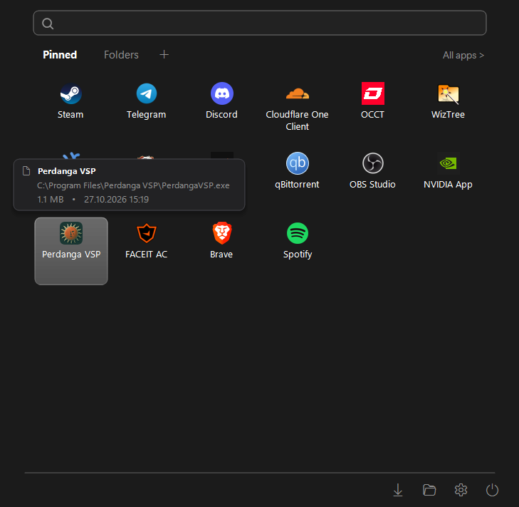
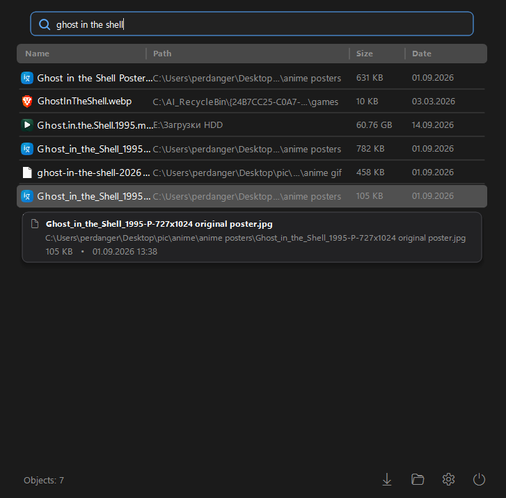

<div align="center">


<h1 align="center">Perdanga11</h1>

<p align="center">
  <b>Replacement for the Windows 11 Start Menu.</b>
</p>

<br/>

<table align="center">
  <tr>
    <th align="center">Start Menu</th>
    <th align="center">Instant Search</th>
  </tr>
  <tr>
    <td align="center"></td>
    <td align="center"></td>
  </tr>
</table>

</div>

## Highlights & Features

- **Fast Start:** Written entirely in pure native C++ with zero third-party dependencies.
- **High-Performance Search:** Instant search across installed applications, user libraries, and connected drives with an ultra-lightweight virtual table.
- **Custom Categorized Tabs:** Organize your workspace with customizable tabs (Pinned, Folders, Tools, Games, etc.). Drag-and-drop tiles to rearrange, rename tabs, or create new categories with a simple right-click.
- **Consecutive Multi-Launch:** Launch multiple programs in succession without the menu auto-closing simply by holding `Shift` while clicking (or via middle mouse click). Standard single-click launches and dismisses immediately.
- **Rich Fluent Tooltips:** Hovering any tile or search result displays an info card with resolved target path, file size, and last modified timestamp.
- **Deep Shortcut Resolution:** Accurately resolves `.lnk` shortcuts to actual file targets for execution, location opening, and path copying.
- **Native Explorer Pinning & SendTo:** Pin files, folders, and executables directly from Windows Explorer or the Desktop.
- **Theme Support:** Automatically adapts to Windows 11 dark and light modes.

## 📂 Project Structure

```text
Perdanga11/
├── assets/                  # Graphical assets
│   ├── ico/
│   │   └── perdanga11.ico   # Application icon
│   ├── logo/
│   │   └── perdanga11.png   # Fluent brand logo
│   ├── Perdanga11menu.png   # Start menu preview
│   └── Perdanga11search.png # Instant search preview
│
├── src/                     # Core Application Source Code
│   ├── AppIndexer.hpp       # Asynchronous file indexer, icon cache & search scorer
│   ├── Config.hpp           # State management, INI serializer & localization
│   ├── Hooks.hpp            # Keyboard/mouse low-level hooks & UI Automation
│   ├── MenuInteraction.hpp  # Context menus, modal dialogs & system power actions
│   ├── MenuRenderer.hpp     # GDI+ double-buffered visual rendering pipeline
│   ├── MenuState.hpp        # Window state, debounced search worker & animation
│   ├── MenuWindow.hpp       # Main Win32 window message loop & event handler
│   ├── main.cpp             # Entry point, single-instance mutex & tray icon
│   ├── resource.h           # Resource ID definitions
│   └── resource.rc          # Windows resource compiler definition
│
├── installer/               # Distribution & Installer
│   ├── installer.cpp        # Lightweight standalone C++ setup utility
│   ├── installer.rc         # Embedded payload resources
│   └── setup.iss            # Inno Setup compilation script with custom theme
│
├── bin/                     # Output Directory for Binaries
│   ├── Perdanga11.exe       # Compiled executable
│   └── config.ini           # User layout and tab configuration
│
├── build/                   # Temporary build artifacts (.obj, .res)
├── dist/                    # Packaged installers (Perdanga11_Setup.exe)
├── build.bat                # Automated one-click compilation & packaging script
└── clean.bat                # Cleanup script for temporary build artifacts
```


## Build

### Prerequisites

1. **Windows 10 / 11 (64-bit)**
2. **Visual Studio 2022** (or MSVC Build Tools) with the **"Desktop development with C++"** workload.
3. **Inno Setup 6** (Optional, required only for compiling the setup installer wizard).


### Step-by-Step Compilation Guide

1. Open **x64 Native Tools Command Prompt for VS**.
2. Navigate to the project folder:
   ```cmd
   cd "C:\Path\To\Perdanga11"
   ```
3. Run the master build script:
   ```cmd
   build.bat
   ```

The script will automatically:
- Compile application resources (`resource.rc`).
- Compile and link `bin\Perdanga11.exe`.
- Prepare high-resolution installer artwork from `assets\logo\perdanga11.png`.
- Compile the setup installer (`dist\Perdanga11_Setup.exe`) if Inno Setup is present.
- Launch `Perdanga11.exe` immediately for testing.

<br>

<div align="center">
  
  <br><br>
  <h2>Perdanga Forever!</h2>
</div>

  
  <br><br>
  <h2>Perdanga Forever!</h2>
</div>
